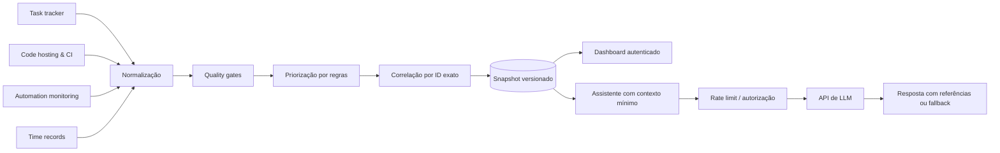

# IT Operations Copilot — Architecture & Data Contracts

> **Public-safe portfolio blueprint:** architecture, JSON Schemas, synthetic fixtures and contract tests. No production workflow exports, private endpoints, credentials, operational records or company identifiers.

[](https://github.com/ArnoldReis/gest-otempon8n/actions/workflows/validate.yml)

## Por que este projeto existe?

Um time de tecnologia costuma administrar chamados, revisões de código, falhas de automações e horas rastreadas em fontes diferentes. Este estudo apresenta a **arquitetura de referência** de um copiloto operacional com visão executiva, alertas auditáveis e respostas de IA **fundamentadas em snapshots**.

O projeto demonstra decisões de engenharia: ingestão orientada a contratos, qualidade dos dados, priorização determinística, correlações por identidade, segurança das sessões e uso responsável de modelos de linguagem.

### Fluxo conceitual



## O que os contratos cobrem?

| Contrato | Responsabilidade |
| --- | --- |
| `task` | Estado, prioridade, pessoas atribuídas e bloqueios |
| `time-entry` | Apontamento de tempo na ferramenta de tarefas |
| `time-review` | Sessão automática separada e status de conferência |
| `pr` | Pull request, CI e revisão |
| `automation-event` | Estado observado e recorrência de erros |
| `delivery-event` | Transições de criação, conclusão ou reabertura com evidência obrigatória |
| `operational-insight` | Correlações justificadas e indicadores de cobertura |
| `snapshot` | Captura consolidada e flags de confiabilidade |
| `ai-query` | Pergunta limitada a snapshot |
| `ai-response` | Resposta com referências e avisos de incerteza |

## Regras de segurança e evidência

- Fontes **somente leitura**; a IA não modifica chamados ou workflows.
- Relacionar uma prioridade ao tempo apenas quando `task.id === time_entry.task_id`.
- Distinguir pessoas responsáveis daquelas que **registraram** o tempo.
- **Nunca somar** apontamentos do task tracker a horas de controle automático: podem medir o mesmo esforço.
- Horas capturadas, pendentes e confirmadas são medidas diferentes. ROI precisa de confirmação e premissas documentadas.
- Ausência de apontamentos não comprova ausência de trabalho; tempo alto não é indicador isolado de baixa produtividade.
- Contar falha como recorrente somente se o estado mais recente confirma erro.
- Uma fonte indisponível não deve produzir métricas iguais a zero. Exibir `partial`, `error` e data da captura.
- A IA só recebe contexto mínimo, retorna referências e sinaliza incertezas; nenhuma chave é enviada ao navegador.

## Estrutura

```text
schemas/             10 JSON Schemas (Draft 2020-12)
examples/            registros exclusivamente fictícios
docs/                arquitetura, trade-offs, segurança e case de portfólio
tests/               verificações de contratos, invariantes e privacidade
.github/workflows/   CI com Python e jsonschema
blueprint.json       etapas conceituais, não importável no n8n
```

### Executar testes

```bash
python -m pip install -r requirements-dev.txt
python -m unittest discover -s tests -v
```

Não requer serviços externos, credenciais ou servidor n8n.

## Limites de escopo

**Este repositório não é o código de um produto implantado nem um workflow n8n exportado.** Os contratos e exemplos são uma reconstrução educacional sanitizada. Não documenta nomes de pessoas reais, servidores, relatórios, URLs de empresa, custos nem KPIs internos. As decisões representam um padrão reaproveitável para arquiteturas de automação empresarial.

Veja [Histórico de entregas e sessões de chat](docs/event-history.md), [Arquitetura](docs/architecture.md), [Segurança](docs/security.md), [Modelagem](docs/modeling-decisions.md) e [Case de engenharia](docs/portfolio-case-study.md).

**Licença:** não definida; a publicação pública não implica permissão de reutilização.
