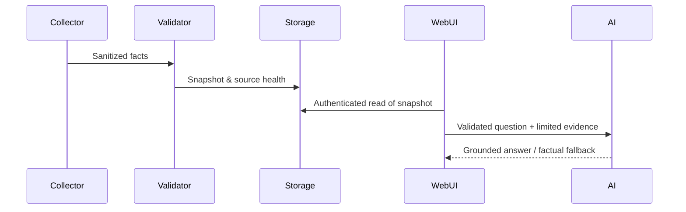

# Arquitetura de referência (fictícia)

Este desenho foi reconstruído para estudo e não contém topologia real, URLs privadas ou workflows exportados.

## Pipeline de dados

1. **Ingestão somente leitura:** APIs de tarefas, revisão de código, monitoramento de automações e controle de horas.
2. **Qualidade e normalização:** tipos e timestamps explícitos; erros de integração marcados como `partial` ou `error`, nunca zerados.
3. **Priorização auditável:** indicadores P0–P3 fundamentados em atrasos, dependências, CI e erros efetivamente verificados.
4. **Correlação:** IDs idênticos entre tarefa e apontamento. O responsável atual pode ser diferente da pessoa que registrou as horas.
5. **Captura:** snapshot versionado com data, fontes e limites da observação.
6. **Visão executiva:** indicadores, linha de datas observadas, SLA verificado, histórico sem alegar entregas concluídas.
7. **Assistente:** somente dados mínimos da captura; nenhuma escrita; fallback determinístico para saída inválida do modelo.

## Contratos de consistência

- `SLA vencido`: só se existir um alvo configurado e uma data/estado que comprove a violação.
- `Falha recorrente confirmada`: última execução em erro + múltiplas falhas observadas.
- `Tarefas sem horas`: apenas ausência de vínculo na captura, nunca trabalho inexistente.
- `Horas pendentes`: nunca misturar com horas confirmadas em custos ou retorno financeiro.
- `Histórico`: volumes de capturas não são métricas de entregas; comparar apenas datas realmente observadas.

`blueprint.json` documenta estágios conceituais e **não é importável no n8n**.

