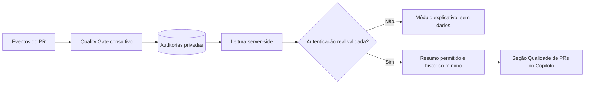

# Quality Gate no Copiloto — módulo centralizado

> **Blueprint público e sintético.** Este documento descreve somente um padrão de interface, não uma exportação de automação corporativa nem configuração de produção.

## Objetivo de UX

Manter todas as informações do time em **um único painel**, sem transformar cada integração em um dashboard diferente. As áreas têm responsabilidades distintas:

| Módulo | Pergunta respondida | Não confundir com |
| --- | --- | --- |
| Visão geral | O que precisa de atenção agora? | Histórico completo |
| Gestão e Entregas | O que avançou e foi comprovadamente concluído? | CI aprovado |
| **Qualidade de PRs** | Quais alterações têm CI e políticas verificadas? | Entrega de chamados |
| Tempo rastreado | Quanto foi apontado ou está pendente de conferência? | Qualidade individual |
| Assistente | O que as evidências do snapshot permitem responder? | Autoridade de aprovação |

A navegação leva à **seção interna** de Qualidade de PRs no painel principal, posicionada perto de Entregas, sem criar uma segunda URL.

## Informação em camadas

1. **Visão rápida** — até três números (aprovados, pendentes, reprovados), estado da fonte e data da captura; usar travessão para dado indisponível, nunca zero fictício.
2. **Auditorias** — visualização sob demanda com filtros de período/status e linhas deduplicadas pelo identificador do PR + SHA, motivos curtos e indicador de revisão manual.
3. **Entenda os pareceres** — explicação acessível de cada categoria e diferença entre falha de CI e problema de infraestrutura.

## Regras de auditoria

- Status: `APROVADO`, `PENDENTE` ou `REPROVADO`, conforme evidência técnica.
- `PENDENTE` inclui CI em andamento, rate limit, timeout, indisponibilidade, quota/runner e arquivos incompletos.
- Um workflow CI com status verde **não garante** que seus jobs e passos obrigatórios foram executados.
- Histórico de testes e políticas antigas **não entram** em indicadores operacionais.
- Agrupar eventos por identidade de PR/commit; não somar várias reavaliações do mesmo commit.
- PR aprovado **não implica** tarefa concluída ou merge realizado.
- Evitar números da empresa, nomes de colaboradores e evidências brutas do GitHub no HTML.

## Segurança / rollout por etapas

**A interface pode ser publicada antes da disponibilidade dos dados**, mas o backend deve manter o resultado da auditoria exclusivamente no servidor enquanto o endpoint de leitura não autenticar o usuário real.

Tokens temporários de chat, links não divulgados e `noindex` **não** fazem autenticação perimetral. Proteger leitura/chat com uma camada de identidade (por exemplo, Cloudflare Access) e validar negação de acesso anônimo antes de ativar dados.

Após autenticar: consultar somente os registros autorizados no servidor, reduzir campos permitidos, restringir volume e período, escapar saídas HTML, não embutir headers/segredos, e manter logs de acesso mínimos.

## Checklist de aceite

- [x] Seção única no painel já existente, sem novo dashboard.
- [x] Visão rápida legível e abas de detalhamento/ajuda.
- [x] Dado real não serializado enquanto acesso anônimo for possível.
- [x] Renderização falha de modo seguro: HTML original é preservado se não houver snapshot válido.
- [ ] Autenticação perimetral implantada e validada.
- [ ] Leitura real de PRs autorizada; deduplicação e filtros testados no navegador.
- [ ] Homologação de layout desktop/mobile e WCAG básica.
- [ ] Teste de evento real, atualização de SHA e persistência do Quality Gate.

O exemplo HTML nesta pasta é inteiramente fictício; não faz requisições externas.
